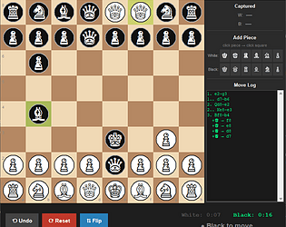

# Chess: Basic Edition

A two-player chess board for your desktop, written in Python with Tkinter. Pick up a piece, put it down anywhere, and play the way you would on a real board at a table.

**[Project page](https://cloudbv.github.io/chess_basic/)** | **[Play it on itch.io](https://cloudbv.itch.io/chess-basic)**



## What it is

A single-file app that sets up the standard starting position and then gets out of the way. It does not enforce the rules: any piece can go to any square, so players agree on legality themselves, just like with a wooden set. That also makes it handy for setting up puzzles, replaying positions, or teaching.

## Features

- **Pick up and put down:** click a piece to lift it, then click a square to drop it. Landing on an occupied square captures that piece.
- **Undo:** steps back through every action, restoring the board, captures, move number, turn and both clocks.
- **Flip the board:** view the game from Black's side, with labels and clicks flipping correctly.
- **Clocks:** a count-up timer for each side, running only for the player to move.
- **Captured pieces:** listed in the sidebar for each side, sorted from queen down to pawn.
- **Piece bank:** add any piece of either colour to any square, for custom positions.
- **Move log:** a scrolling record of every move, such as `1. e2-e4`, with `x` for captures.
- **Last-move highlight:** the squares a piece left and landed on are tinted.

## How to play

| Action | How |
| --- | --- |
| Move a piece | Click it, then click the destination. The turn passes to the other side. |
| Capture | Drop your piece on an opponent's piece. |
| Remove a piece | While holding a piece, click outside the board. |
| Add a piece | Click a piece in the "Add Piece" bank, then click a square. |
| Undo / Reset / Flip | Buttons along the bottom. Reset returns to the starting position and zeroes the clocks. |

## Run it

You need Python 3 with Tkinter, which ships with the standard Python installers on Windows and macOS. Nothing else to install.

```bash
git clone https://github.com/cloudbv/chess_basic.git
cd chess_basic
python3 chess.py
```

On some Linux distributions Tkinter is a separate package, for example `sudo apt install python3-tk` on Debian and Ubuntu.

## Customize

Every colour and size is a constant at the top of the file. Change `SQUARE_SIZE` to resize the whole board, or swap the hex values to restyle it.

```python
SQUARE_SIZE = 72
COLOR_LIGHT = "#f0d9b5"
COLOR_DARK  = "#b58863"
COLOR_HELD  = "#7fc97f"
```

## Limitations

There is no check, checkmate, castling or en passant logic, and no computer opponent. The app tracks positions, not rules. The move log records what moved and where, so it is a simple log rather than full algebraic notation.

## Author

Made by Yosef Setiawan.
